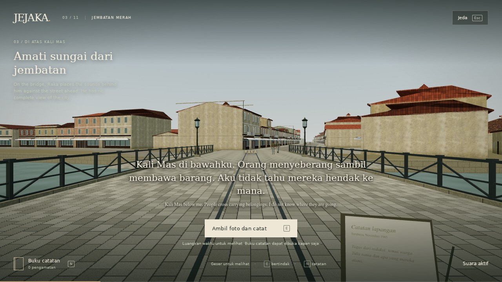
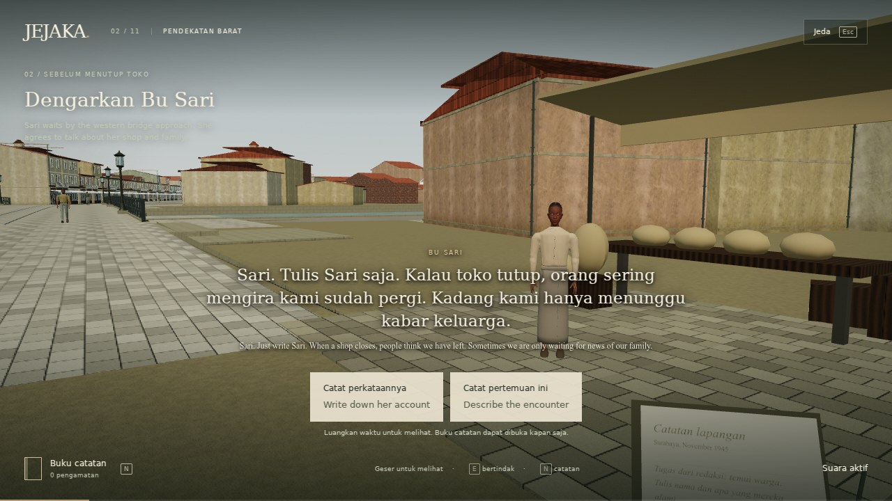

# Field edition visual reference

Actual browser captures at 1280×720, pixel ratio 1, using Chromium 133 software WebGL and the balanced quality profile. These show the reconstructed production scene, not historical photographs. They are reference views for continued development; they do not establish target-device frame rate or photographic realism.

## Bridge

The delivery geometry corrects broad floating timber roof plates and adds roof-edge thickness. Bridge lamps, rail joins, paving, plaster, wall finishes and the river are refined presentation assets.

## Sari encounter

Sari’s head remains visible above the captions. Her face, hands, clothing and shoes use the rebuilt model; the body rig and motion remain stylized. A full facial performance and contact-solved prop handling are separate production work.
